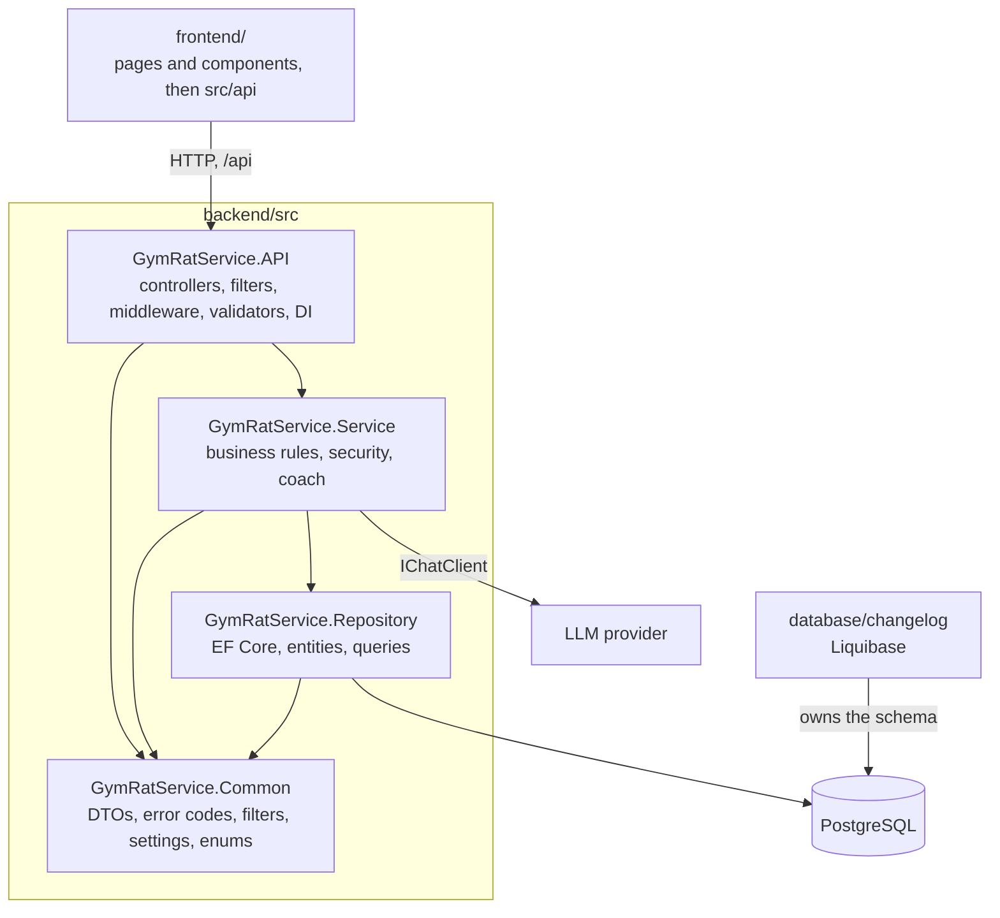
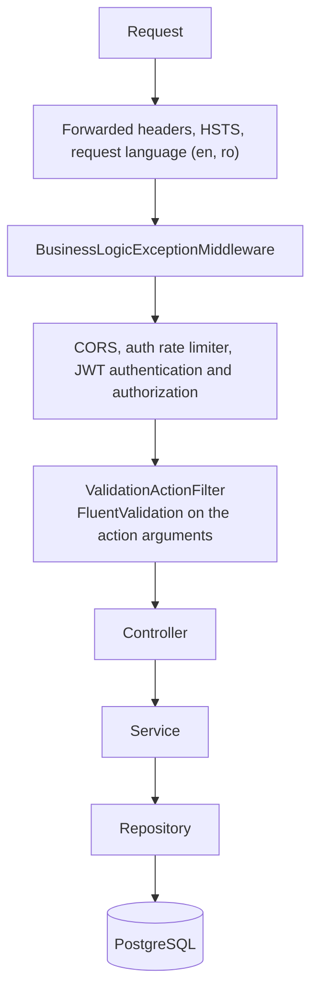
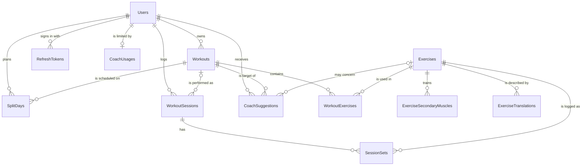

# Architecture

A gym workout tracker: a React single-page app, a .NET 10 Web API and PostgreSQL, with the schema managed by Liquibase. Setup and settings are in the [README](../README.md), operations in the [runbook](RUNBOOK.md), and the main choices in [decisions](decisions/README.md).

## Layers

Calls go `API -> Service -> Repository`, never back. Controllers only map HTTP to a service call. Services depend on repository interfaces, not on `DbContext`. Repositories hold data access. Entities stay inside the backend; the API returns DTOs. `AddServiceLayer` registers the repository layer, so the API project does not reference it directly. The API project builds the LLM client (`AiCoachExtensions`).

`infra/docker-compose.yml` runs Postgres, a one-off Liquibase update, the API and nginx. nginx serves the built frontend and proxies `/api`, so both share one origin. The Vite dev server proxies `/api` too.

## Request flow

- Errors: a service throws `BusinessLogicException` with a code, or the validation filter throws `ValidationException`. The middleware answers 400 with a localized `{ code, message }`, plus `errors` for validation ([003](decisions/003-business-errors-return-400.md)).
- Validators live in `API/Validators`. Coach tools do not pass through the HTTP filter, so they call `IInputValidator` themselves.
- Identity: controllers are `[Authorize]` by default, and anonymous actions opt out. Controllers pass `User.GetUserId()` to the service, which checks ownership. Another user's resource gets the same "not found" code as a missing one.
- Frontend: API calls go through `src/api/client.ts`. It keeps the access token in memory and, on a 401, refreshes the session once and retries. The refresh token is an `HttpOnly` cookie (see "Sessions and refresh tokens" in the README).
- Coach: `POST /api/chat/messages` runs a tool loop whose tools call the same services with the signed-in user's id ([009](decisions/009-coach-changes-need-confirmation.md)).

## Data model

- `Exercises` (entity `ExerciseCard`) is a shared catalog seeded by Liquibase. The other tables hold user data, owned directly or through a parent row, and it is deleted with the account.
- Deleting a workout keeps its sessions and their sets: `WorkoutSessions.WorkoutId` becomes null.
- A user has at most one unfinished session (a partial unique index) and at most one workout per split day.
- Ids are UUID v7 ([008](decisions/008-uuid-v7-ids.md)) and weights are kilograms ([004](decisions/004-weights-in-kilograms.md)). The two exercise child tables are keyed by the exercise and a value instead of an id.

## Tests and CI

Backend unit tests mock the repository interfaces. Integration tests call the endpoints, normally on SQLite, and CI also runs a smaller set against PostgreSQL ([002](decisions/002-sqlite-for-tests.md)). The frontend uses Vitest and React Testing Library. `e2e/` holds a Playwright smoke test. The CI jobs are in `.github/workflows/ci.yml`.
